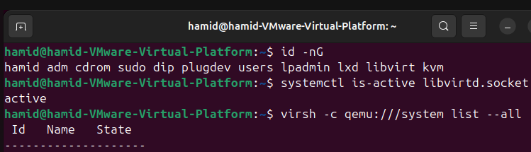
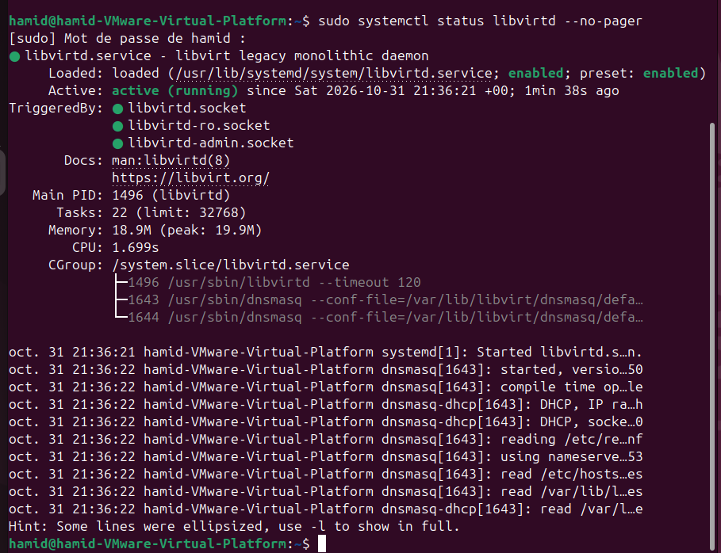
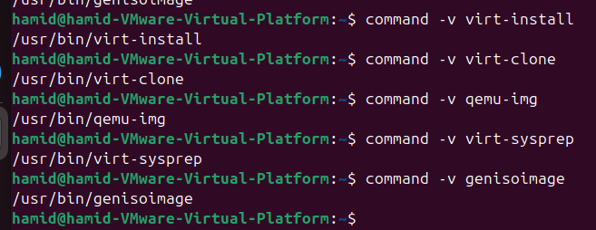

# TP n°1 — Virtualisation avec KVM/QEMU et libvirt

## Partie A — Préparer l’environnement

**Module :** Virtualisation et Cloud Computing — Master BD2C, FSAC, 2026/2027  
**Parcours choisi :** Ubuntu 24.04 LTS  
**État :** installation et contrôle des outils validés ; capture complète du diagnostic de l’hôte à compléter.

### 1. Environnement de travail

Le poste hôte physique utilise Windows 10 et VMware Workstation. Le TP est réalisé sur une machine virtuelle Ubuntu Desktop 24.04.5 LTS disposant de la virtualisation imbriquée Intel VT-x/EPT. Ubuntu est installé sur un disque virtuel VMware d’une capacité d’environ 100 Go, conservé sur un disque dur externe. Cette machine Ubuntu constitue **l’hôte KVM** : les VM du TP seront créées à l’intérieur avec QEMU/KVM et libvirt.

Résultats effectivement relevés dans l’Ubuntu installé :

| Élément | Valeur relevée |
|---|---|
| Distribution | Ubuntu 24.04.5 LTS (Noble) |
| Architecture | x86_64 (à illustrer par la nouvelle capture `lscpu`) |
| Périphérique KVM | `/dev/kvm` présent : `crw-rw----+ 1 root kvm 10,232` |
| Mémoire totale (avant ajustement VMware) | 2,9 Gio |
| Mémoire disponible lors de la mesure | 1,7 Gio |
| Swap | 2,9 Gio |
| Système de fichiers racine | `/dev/sda2` |
| Capacité du système de fichiers `/` | 98 Go |
| Espace disponible sur `/` | 84 Go |

### 2. Exercice 1 — Vérifier la virtualisation

Les contrôles demandés dans le TP sont :

```bash
lscpu
grep -Eoc '(vmx|svm)' /proc/cpuinfo
lsmod | grep kvm
test -e /dev/kvm && ls -l /dev/kvm
df -h /var/lib/libvirt
free -h
```

`vmx` désigne l’extension de virtualisation matérielle Intel VT-x, tandis que `svm` désigne la technologie AMD-V. La présence des modules noyau et de `/dev/kvm` constitue un diagnostic préalable favorable, à compléter par une vérification pratique de l’accélération.

**Observation constatée :** le périphérique `/dev/kvm` existe après l’installation permanente d’Ubuntu. La capacité du disque virtuel et l’espace disponible sont suffisants pour commencer les exercices. Le processeur et le compteur `vmx/svm` seront documentés par la capture actuelle de l’hôte.

**Capture à ajouter :** `captures/A1-01_Diagnostic_virtualisation_KVM.png` (commandes réellement exécutées et sorties lisibles).

### 3. Exercice 2 — Installer et contrôler les outils

Les paquets du parcours Ubuntu ont été installés à l’aide de la commande :

```bash
sudo apt update
sudo apt install -y qemu-kvm libvirt-daemon-system libvirt-clients \
  virtinst virt-manager virt-viewer qemu-utils libguestfs-tools genisoimage
sudo systemctl enable --now libvirtd
sudo usermod -aG libvirt,kvm "$USER"
```

Après reconnexion, les vérifications observées sont les suivantes :

| Test | Sortie réellement constatée | Interprétation |
|---|---|---|
| `id -nG` | `... libvirt kvm` | Permissions de groupe appliquées |
| `systemctl is-active libvirtd.socket` | `active` | Socket libvirt opérationnelle |
| `virsh -c qemu:///system list --all` | Tableau vide sans erreur | Connexion au démon libvirt réussie ; aucune VM créée à ce stade |
| `virsh -c qemu:///system net-list --all` | `default active yes yes` | Réseau NAT `default` actif et démarrage automatique |
| `sudo systemctl status libvirtd --no-pager` | `active (running)` | Service opérationnel lors du contrôle |

Le service libvirt peut fonctionner avec l’activation par sockets : une période d’inactivité n’implique pas forcément un échec tant que les sockets et les commandes `virsh` fonctionnent.

Les cinq commandes exigées par le TP sont disponibles :

```text
/usr/bin/virt-install
/usr/bin/virt-clone
/usr/bin/qemu-img
/usr/bin/virt-sysprep
/usr/bin/genisoimage
```

**Capture A2-01 — Groupes, socket et connexion libvirt :**



**Capture A2-02 — Service libvirtd actif :**



**Capture A2-03 — Disponibilité des outils :**



**Capture à ajouter :** `captures/A2-04_Reseau_NAT_default.png` pour confirmer visuellement le réseau `default`.

### 4. Validation et conclusion provisoire

La connexion `qemu:///system` répond, les outils de gestion sont installés et le réseau NAT `default` est actif. **La Partie A est donc fonctionnelle et prête pour la création de la première VM KVM.** Il reste à compléter les captures de diagnostic et du réseau NAT pour documenter intégralement le compte rendu.

### 5. Étape suivante

Partie B, exercice 3 : télécharger l’ISO officielle Ubuntu Server 24.04, contrôler sa somme SHA-256, la copier vers `/var/lib/libvirt/boot/ubuntu.iso` et vérifier le réseau. Le téléchargement est **en cours** au moment de la préparation de ce document : aucune validation SHA-256 n’est encore revendiquée.

### 6. Difficultés rencontrées (à présenter brièvement dans le compte rendu final)

- La virtualisation imbriquée a nécessité le démarrage Windows dédié au TP avec l’hyperviseur Windows inactif.
- Le disque dur externe hébergeant VMware s’est momentanément déconnecté pendant les premières tentatives d’installation Ubuntu ; le système de fichiers NTFS a ensuite été réparé et vérifié intègre. La stabilité matérielle reste à surveiller.

Ces difficultés concernent la mise en place du laboratoire et ne remplacent pas les preuves demandées dans les exercices.
